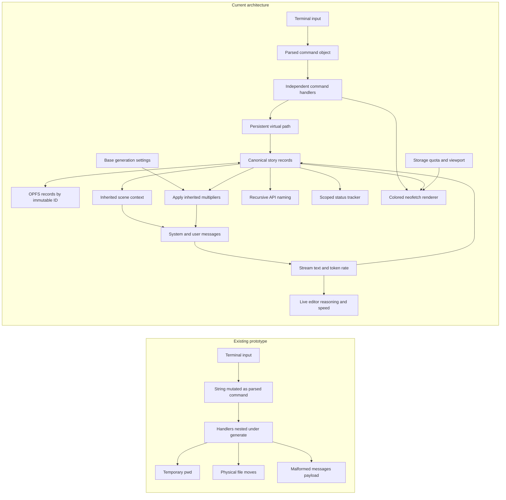

# Cherenkov

Cherenkov is a framework-free, browser-based story generator controlled through a small shell. Its runtime files are `index.html`, `styles.css`, `main.js`, `Jua-Regular.ttf`, and `VT323-Regular.ttf`. This README is documentation only.

The workspace responds from wide desktop layouts down to narrow phone screens. The editor remains the primary surface, creative controls feed directly into scene prompts, and the combined terminal uses the bundled `VT323-Regular.ttf` font with a monospace fallback.

Generation streams OpenAI-compatible chat-completion deltas into the active editor. A compact token-rate indicator shows a live estimate during streaming and the provider-reported completion rate when usage metadata arrives.

Reasoning-capable providers can stream `reasoning_content`, `reasoning`, or `thinking` separately from story text. Generation settings offer an optional `reasoning_effort`; leaving it at provider default omits the field from the request.

Creative controls inherit through `global defaults → folder → book → chapter → scene`. A record stores only the values edited at that level; reset removes its local overrides. Generation instructions follow the same rule, whether edited in the panel or supplied after a generate path. Length, chaos, pacing, and tension range from `0.50x` to `1.50x`, with `1.00x` at the center. They multiply the base `max_tokens`, `temperature`, `top_p`, and `presence_penalty` values configured in generation settings. Dialogue share and prose notes remain prompt guidance.

Serve the directory over localhost so the browser can use Origin Private File System (OPFS):

```powershell
python -m http.server 8000
```

Then open `http://localhost:8000`.

## Commands

```text
mkdir -p /folder/book/chapter
touch /folder/book/chapter/scene
load /folder/book/chapter/scene
save
ls /
ls -r /
pwd
cd /folder/book
mv /folder/book/chapter/scene /folder/book/chapter/new-name
rm /folder/book/chapter/new-name
rm -rf /folder/book
rmdir /empty-folder
rmdir -rf /folder/book
generate /folder/book
generate /folder/book "Resolve the rivalry during the storm"
generate -r /folder/book
generate --missing /folder/book
generate --dry-run --stale /folder/book
tracker new revision-state /folder/book/chapter
tracker show
tracker delete revision-state
neofetch --ascii boykisser
neofetch --ascii cherenkov
neofetch --ascii snep
color pink
clear
help
```

Short flags can be combined, so `rm -rf /folder/book` is the same as
`rm --recursive --force /folder/book`.

| Command | Flags |
| --- | --- |
| `ls` | `-r`, `--recursive` lists all descendants instead of immediate children. |
| `mkdir` | `-p`, `--parents` creates missing folder, book, and chapter records. |
| `mv` | `-f`, `--force` replaces an existing destination of the same type. |
| `rm` | `-r`, `--recursive` removes containers; `-f`, `--force` suppresses missing-path errors. |
| `rmdir` | Removes an empty folder, book, or chapter; `-r`, `--recursive` includes its descendants; `-f`, `--force` suppresses missing-path errors. |
| `generate [flags] [path] [instruction (optional)]` | Instructions are stored on that record and inherited by its children. `-r`, `--recursive` asks the API to name generated descendant scenes; `-m`, `--missing`; `-s`, `--stale`; `-f`, `--force`; `-n`, `--dry-run`. |
| `tracker` | `tracker new <name> [path]` creates or reopens a named tracker in that domain; `tracker show` lists coverage; `tracker delete <name>` and `tracker rm <name>` delete it. |
| `neofetch` | `-a`, `--ascii` accepts `boykisser`, `cherenkov`, or `snep`. The flag is optional. |
| `color` | Sets the entire site's persistent color scheme. Run it without an argument to list the palette, choose a named color, use a custom six-digit hex color such as `color #7dd3fc`, or use `reset` to restore cyan. |

`neofetch` renders each source photo as 128-by-60 ASCII using the original sampled RGB color for every character. Flat areas use quiet dots, while detected edges move through a progressively denser symbol ramp. The larger terminal is vertically resizable and also shows the current endpoint and model, viewport, browser storage usage and quota, story-record counts, the active path and generation parameters. Its median token rate uses generation samples recorded for the currently selected endpoint and model, so switching either one starts with no matching samples.

Paths use the fixed hierarchy `/folder/book/chapter/scene`. OPFS stores each record as `/records/<immutable-id>.json`; moving a story node changes its virtual `path` and its descendants, not its storage filename.

Recursive generation makes a second, small API request after each successful descendant scene. The response is converted into a filesystem-safe, unique slug and moved through the normal record path logic. Naming failures leave the generated scene at its existing path.

Trackers are named, scoped text fields. A tracker rooted at a chapter appears in Creative Controls for that chapter and its scenes, but not elsewhere. Definitions store only the tracker name and domain; the entered text is stored on each folder, book, chapter, or scene record. Deleting a tracker removes its definition and its values from every record.

## Architecture change



The terminal changes navigation and records, the editor changes the loaded scene, the explorer reflects stored virtual paths, and the configuration panel supplies the OpenAI-compatible endpoint, key, model, and system prompt.
