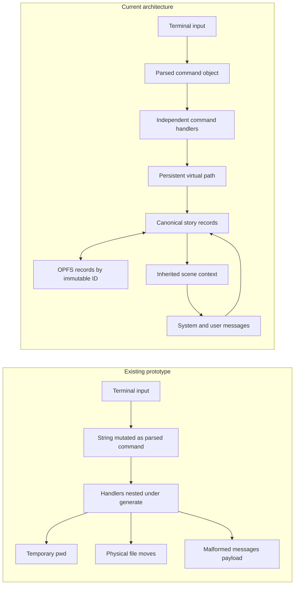

# Cherenkov

Cherenkov is a dependency-free, browser-based story generator controlled through a small shell. The application remains four runtime files: `index.html`, `styles.css`, `main.js`, and `Jua-Regular.ttf`. This README is documentation only.

Serve the directory over localhost so the browser can use Origin Private File System (OPFS):

```powershell
python -m http.server 8000
```

Then open `http://localhost:8000`.

## Commands

```text
mkdir /folder
mkdir /folder/book
mkdir /folder/book/chapter
touch /folder/book/chapter/scene
load /folder/book/chapter/scene
save
ls /
pwd
cd /folder/book
mv /folder/book/chapter/scene /folder/book/chapter/new-name
rm /folder/book/chapter/new-name
generate /folder/book
generate --missing /folder/book
clear
help
```

Paths use the fixed hierarchy `/folder/book/chapter/scene`. OPFS stores each record as `/records/<immutable-id>.json`; moving a story node changes its virtual `path` and its descendants, not its storage filename.

## Architecture change



The terminal changes navigation and records, the editor changes the loaded scene, the explorer reflects stored virtual paths, and the configuration panel supplies the OpenAI-compatible endpoint, key, model, and system prompt.
