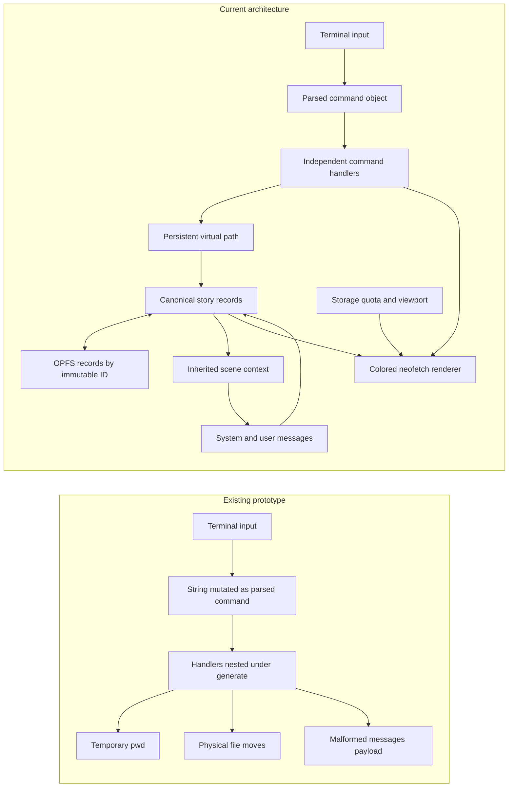

# Cherenkov

Cherenkov is a framework-free, browser-based story generator controlled through a small shell. Its runtime files are `index.html`, `styles.css`, `main.js`, `Jua-Regular.ttf`, and `VT323-Regular.ttf`. This README is documentation only.

The workspace responds from wide desktop layouts down to narrow phone screens. The editor remains the primary surface, creative controls feed directly into scene prompts, and the combined terminal uses the bundled `VT323-Regular.ttf` font with a monospace fallback.

Creative controls inherit through `global defaults → folder → book → chapter → scene`. A record stores only the values edited at that level; reset removes its local overrides. Generation maps length to `max_tokens`, chaos to `temperature`, pacing to `top_p`, and tension to `presence_penalty`. Dialogue share and prose notes remain prompt guidance.

Serve the directory over localhost so the browser can use Origin Private File System (OPFS):

```powershell
python -m http.server 8000
```

Then open `http://localhost:8000`.

## Commands

```text
mkdir -p /folder/book/chapter
touch /folder/book/chapter/scene
load /folder/book/chapter/scene
save
ls /
ls -r /
pwd
cd /folder/book
mv /folder/book/chapter/scene /folder/book/chapter/new-name
rm /folder/book/chapter/new-name
rm -rf /folder/book
generate /folder/book
generate --missing /folder/book
generate --dry-run --stale /folder/book
neofetch --ascii boykisser
neofetch --ascii cherenkov
neofetch --ascii snep
color pink
clear
help
```

Short flags can be combined, so `rm -rf /folder/book` is the same as
`rm --recursive --force /folder/book`.

| Command | Flags |
| --- | --- |
| `ls` | `-r`, `--recursive` lists all descendants instead of immediate children. |
| `mkdir` | `-p`, `--parents` creates missing folder, book, and chapter records. |
| `mv` | `-f`, `--force` replaces an existing destination of the same type. |
| `rm` | `-r`, `--recursive` removes containers; `-f`, `--force` suppresses missing-path errors. |
| `generate` | `-m`, `--missing`; `-s`, `--stale`; `-f`, `--force`; `-n`, `--dry-run`. |
| `neofetch` | `-a`, `--ascii` accepts `boykisser`, `cherenkov`, or `snep`. The flag is optional. |
| `color` | Sets all regular terminal input and output to `cyan`, `blue`, `green`, `yellow`, `red`, `pink`, or `white`; `reset` restores cyan. |

`neofetch` renders each source photo as 128-by-60 ASCII using the original sampled RGB color for every character. Flat areas use quiet dots, while detected edges move through a progressively denser symbol ramp. The larger terminal is vertically resizable and also shows the current endpoint and model, viewport, browser storage usage and quota, story-record counts, the active path and generation parameters. Its median token rate uses generation samples recorded for the currently selected endpoint and model, so switching either one starts with no matching samples.

Paths use the fixed hierarchy `/folder/book/chapter/scene`. OPFS stores each record as `/records/<immutable-id>.json`; moving a story node changes its virtual `path` and its descendants, not its storage filename.

## Architecture change



The terminal changes navigation and records, the editor changes the loaded scene, the explorer reflects stored virtual paths, and the configuration panel supplies the OpenAI-compatible endpoint, key, model, and system prompt.
